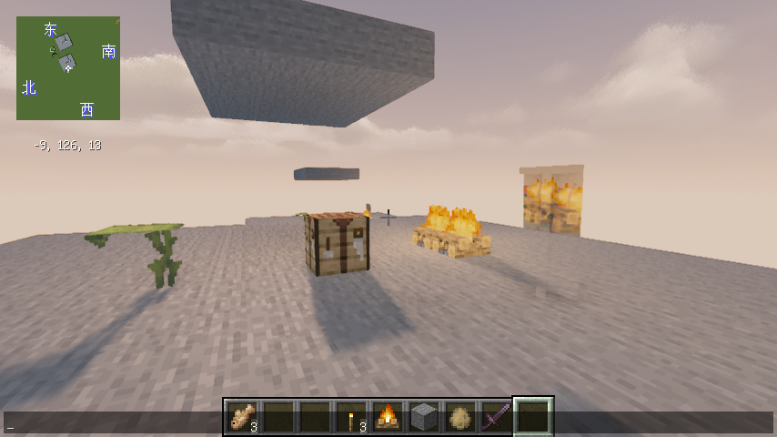

<p align="center">
  
</p>

# Antimony（锑）

**用纯 CPU 软件光栅器接管 Minecraft 的整条渲染管线，并把 Iris 光影包在 CPU 上编译、执行。**

没有 OpenGL 后端，没有 GPU 渲染兜底，也不回读 GPU 画面：每一帧都是 Java 在自己的线程里算出来的。
这也是它叫“负优化整活模组”的原因——同一台机器，它会比原版慢几个数量级。



*854×480，MakeUp-UltraFast 9.6 全部通道由 CPU 计算（含阴影、雾、水面、粒子、HUD 与小地图）。*

## 它做什么

- `GameRenderer.render` 层面接管整帧，vanilla 的 GL 绘制一次都不提交。
- 拦截 blaze3d / LWJGL 的调用，拿到 Iris 预处理后的**真实 shader 源**（顶点、片元、几何、计算）。
- 自写 GLSL 前端 → 类型检查 → 生成 Java → 用 JDK 自带编译器编译成字节码，在 CPU 上跑。
- 自写 tile 光栅器：近平面齐次裁剪、透视校正插值、深度测试、alpha 混合/混合分离、MRT、雾、线框。
- 支持 Iris 的光影包结构：`gbuffers_*`、deferred、composite、shadow、`shaders.properties` 的程序图与渲染目标分配，
  以及 Solas 那类 `compute`/voxel 通道（在 CPU 上按 invocation 展开执行）。
- 成品帧直接写进游戏主画面纹理，再交给 Win32 GDI 呈现，不额外开窗口。

## 当前状态（如实）

能跑：

- 进入世界、走动、开背包与聊天，HUD/GUI 全部由自己重画。
- **MakeUp-UltraFast 9.6**：完整跑通，画面可用。
- **Solas Shader V3.7b**：地形/阴影/voxel/composite 主链路能出帧，但仍有可见缺陷（部分方块实体、噪声、个别过亮图元）。
- Xaero 小地图：用独立写的适配层把 CPU 画面喂给它的地图，不复制其实现。

已知限制：

- 帧率是**秒级**：854×480 下 MakeUp 约 0.9–4.4 秒一帧（画质档位不同），不是可玩帧率，这是项目性质决定的。
- 仅 Windows（呈现层依赖 Win32 GDI）。
- 仅 Minecraft 1.21.1 + NeoForge 21.1.265 + Iris 1.8.x + Sodium 0.8.x，其它版本未验证。
- 光影包兼容性按通道推进，不是“任何包都能跑”。

## 下载

编译好的 jar 在 [Releases](https://github.com/wuliaoppx/IrisGl-Mod/releases) 页面（`antimony-<version>.jar`），
或按下面的步骤自行构建。

## 构建

需要：

- JDK 21（toolchain 解析；也可在**你自己的** `~/.gradle/gradle.properties` 里 `org.gradle.java.home` 固定）
- Gradle 8.10.2（`net.neoforged.moddev` 2.0.148 会拉取 NeoForge 依赖）

Sodium 的配置 API 只用于把画质选项注册进 Sodium 设置页，它是第三方模组，**二进制不随本仓库分发**。
构建前从你已安装的 Sodium 里取一次：

```bash
unzip -o "<实例>/mods/sodium-*.jar" 'net/caffeinemc/mods/sodium/api/*' \
      'net/caffeinemc/mods/sodium/client/config/*' -d /tmp/sodium-api
mkdir -p libs && jar cf libs/sodium-api.jar -C /tmp/sodium-api .
```

或者直接用 `-PsodiumApiJar=<路径>` 指向现成的 jar。该依赖是 `compileOnly`，不会进最终 jar。

```bash
gradle jar          # 产物: build/libs/antimony-<version>.jar
```

装进自己的测试实例（可选，默认关闭，避免仓库里出现本机路径）：

```bash
gradle jar -PinstanceModsDir="D:/mc/.minecraft/versions/1.21.1-NeoForge_21.1.265/mods"
```

## 回归探针

仓库带一组纯 CPU 的数值回归（不需要启动游戏），例如：

```bash
gradle terrainFragmentRasterProbe rasterCullingProbe terrainBlendProbe \
       shaderVaryingAccessProbe cpuImageResourcesProbe
```

少数探针需要“从游戏运行时抓下来的 shader 源”，用 `-Pcaptures=<目录>` 指定（默认 `captures/`，不入库）。

## 目录

```
src/main/java/dev/antimony/
  core/render/    世界渲染各通道、后台缓冲、GUI/HUD、实体与方块实体
  core/irisgl/    IRIS GL 风格的立即模式门面与 tile 光栅器
  gl/glsl/        GLSL 前端、类型/接口匹配、CPU 执行与光影包管线
  gl/shim/        blaze3d/LWJGL 拦截与状态镜像
  core/present/   帧呈现（Win32）
docs/             架构、决策与逐轮实现记录
```

## 第三方与许可

- 代码为 MIT（见 [LICENSE](LICENSE)）。
- 本仓库**不含**任何 Mojang 资产、游戏本体、存档或光影包；也不含第三方模组的二进制。
- Minecraft 是 Mojang/Microsoft 的商标；本项目需要你自备正版游戏。
- IRIS GL 是 SGI 的历史 API，本项目只按公开文档与开源实现的**行为**对齐命名，未复制其代码。
- Sodium / Iris / Xaero 小地图等模组版权归各自作者，本项目仅做运行时接口适配。

## 文档

- [docs/ARCHITECTURE.md](docs/ARCHITECTURE.md) — 架构与通道划分
- [docs/DECISIONS.md](docs/DECISIONS.md) — 关键技术决策

逐轮实现与验证记录（含本机路径、运行 ID 和逐轮证据）属于开发过程材料，保留在开发机上，不随仓库发布。
